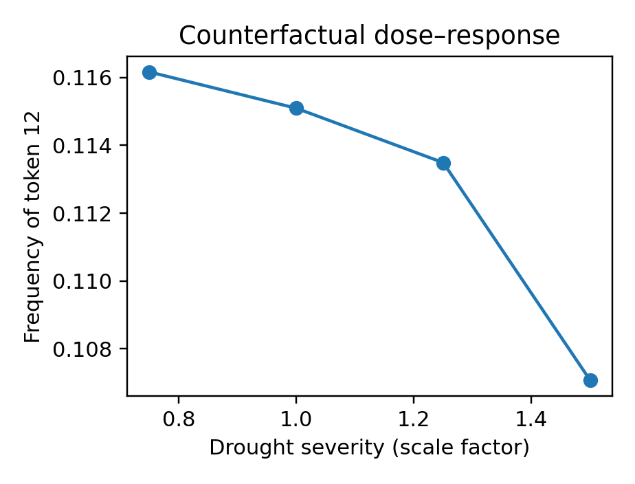

# FloraSpeak

**Can a model learn a "vocabulary" in plant electrical signals?**

Plants produce measurable electrical activity when they're stressed by drought, heat, cold or touch. FloraSpeak is a research pipeline that tests whether self-supervised learning can turn that activity into discrete, reusable "tokens", and whether those tokens say anything useful about the stress a plant is under.

The work was presented as **"PlantTalk"** at the Terra North Jersey STEM Fair (2026), where it placed 3rd of 100+ in Environmental and Plant Science.

> **Data note:** The results in `results/` come from the synthetic generator included here (`generator.py`), not from live plant recordings. The point of the synthetic data is ground truth: we know exactly when each stress happened, so we can check whether the pipeline finds it. Real recordings plug into the same pipeline through a manifest CSV.

## Pipeline

```
generator.py  ->  make_shards  ->  train_ssl  ->  extract_embeddings  ->  train_vq_emb  ->  tokens
 (8-channel        (filter,        (masked          (per-window             (VQ-VAE
  signals +         2.56 s          autoencoder)     embeddings)             codebook)
  stimulus log)     windows)
                                                                      tokens -> analysis
```

1. **Synthetic plants** (`generator.py`). Multichannel recordings across species, plants and sessions, with leaf, stem and root channel topology and randomized stimulus schedules (light, touch, heat, cold, nutrient, drought). Each recording has ground-truth hidden states: hydration, excitability, temperature and nutrient level. It also adds realistic artifacts: line hum, drift, pink and white noise, dropouts, saturation, and circadian modulation.
2. **Preprocessing** (`src/preprocess`, `scripts/make_shards.py`). A notch filter for line hum, band-pass filtering, robust detrending and artifact masking, then 2.56 s sliding windows with a 0.64 s hop.
3. **Self-supervised encoder** (`src/models/ssl_masked.py`). A masked autoencoder for time series learns to reconstruct hidden parts of a window without any labels.
4. **Tokenizer** (`src/models/vq.py`). A vector-quantized VAE with an EMA codebook maps each window's embedding to a discrete token.

## Analyses

| Question | Script | Output |
|---|---|---|
| What does each token look like? | `token_prototypes.py` | Prototype waveforms and spectra per token |
| Do tokens follow each other in patterns? | `token_bigrams.py`, `plot_token_timeline.py` | Bigram frequencies and token timelines |
| Do tokens carry stimulus information? | `analyze_tokens_mi.py` | Mutual information against a shuffled baseline |
| Does token use scale with stress? | `make_dose_dataset.py`, `eval_dose_response.py` | Token frequency vs. drought severity |
| Can it warn before a stress event? | `eval_early_warning.py`, `calibrate_early_warning.py` | AUROC at 15–120 s horizons, calibration |
| Does it transfer across species? | `make_domain_variants.py`, `eval_domain_generalization.py` | Train-on-A / test-on-B AUROC |
| Which channels drive which under stress? | `build_causal_graphs.py`, `graph_invariants.py` | Granger-causal graphs (FDR-corrected), rest vs. stress |
| What are the underlying dynamics? | `fit_dynamics.py` | Koopman (EDMD) modes and SINDy equations |

## Results (synthetic data)

**Cross-species transfer.** Detection works within a species but drops toward chance on a new one, which is the main open problem.

| Train | Test | AUROC |
|---|---|---|
| Species A | Species A | 0.71 |
| Species B | Species B | 0.71 |
| Species A | Species B | 0.59 |
| Species B | Species A | 0.58 |

**Dose response.** As simulated drought gets more severe (0.75× to 1.5×), one token's frequency falls steadily, from 11.6% to 10.7% of windows.



**Early warning.** Predicting a stress event before it starts is weak so far: AUROC is about 0.55 across 15–120 s horizons (0.57 after calibration at 60 s). That is an honest negative result, and it's the next thing to improve.

Figures from the poster are in `results/poster_figures/`.

## Run it

```bash
conda env create -f environment.yml
conda activate floravoice

python generator.py --outdir data/synth --species A,B --plants-per-species 2 --sessions-per-plant 2
python scripts/make_shards.py --manifest data/manifest.csv --outdir data/shards
python scripts/train_ssl.py --index data/shards/index.csv
python scripts/extract_embeddings.py
python scripts/train_vq_emb.py
```

Each analysis script in `scripts/` can then run on its own. Raw data and model checkpoints are git-ignored.

## Next steps

- Record real plants and run the same pipeline on them
- Use domain adaptation to close the cross-species gap
- Add stronger features for early warning, beyond token counts

## Author

Tharun Naguleswaran, Bridgewater-Raritan High School. Licensed under Apache 2.0.
